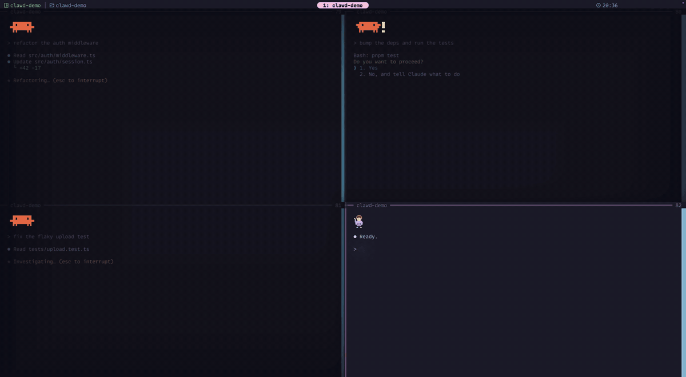

# clawd-in-ghostty

Clawd, the Claude Code mascot, lives in the corner of every tmux pane where Claude is working.
A single Ghostty shader that makes tmux feel alive while you work with Claude Code.



<sub>A real screen recording of Ghostty and tmux. Claude's pane states are scripted so every effect shows up in under 30 seconds.</sub>

## What it does

**Clawd in your panes**

- While Claude is working, Clawd walks, hops, waves and plays the official startup animations in the pane's top-left corner. Up to four panes at once.
- When Claude needs your permission or an answer, Clawd jumps with a `!`.
- When Claude finishes, Clawd celebrates with confetti.
- If a task runs over a minute, Clawd starts stirring a cooking pot.
- Very rarely, Clawd grows legs and turns into something else for a few seconds.

**You, as a little developer**

- Type in a pane where Claude is idle and a hoodie-wearing developer appears: running, sipping coffee, listening to music, typing on a laptop.
- Type while Claude is working and the developer tosses presents to Clawd, who catches them.

**tmux, but nicer**

- Inactive panes are blurred and dimmed, and the active pane casts a soft shadow.
- tmux popups get a modal-style backdrop, a shadow and a glowing edge.
- The screen edge glows while the prefix key is pressed, in copy mode, and while a pane is zoomed.
- The pane edge glows red when the last command failed.
- Fireworks go off after a successful `git push`.

## How it works

A Ghostty shader only sees pixels. It cannot ask tmux where the panes are.
So tmux paints that information as 21 colored cells at the right end of the status bar, and the shader reads them back and hides them.

```
Claude Code hooks ──> ~/.claude/pane-state.json
                              │
tmux status-right ──> scripts/pane-marker.sh ──> 21 colored cells
                                                       │
Ghostty ──> shaders/clawd.glsl reads the cells ──> draws everything
```

## About this repository

This is a reference implementation, not a packaged tool. It was extracted from my own dotfiles and has only been run on my machine. There is no installer, and it will probably need adjusting before it works in your setup.

If you want to borrow the idea, the interesting parts are the marker trick in `scripts/pane-marker.sh` and how `shaders/clawd.glsl` reads it back.

## What it assumes

These are the conditions it was built and tested under. If any of them differ, expect nothing to show up.

- **macOS only.** Tested with Ghostty 1.3.1 and tmux 3.8 on macOS. The shader expects Ghostty on macOS to hand it colors converted to Display P3, so it is unlikely to work on Linux.
- **Ghostty padding must be extended.** The shader reads the first marker value from the corner of the window padding, so the padding has to take the color of the edge cells.

  ```
  window-padding-color = extend-always
  ```

- **tmux status bar at the top.** The marker cells sit at the right end of the top row. `tmux/clawd.tmux` sets `status-position top` and `status-interval 1`, and appends to `status-right`.
- **Claude Code hooks.** `claude/clawd-state.sh` records each pane's state in `~/.claude/pane-state.json`. The hooks it needs are listed in `claude/settings.example.json`.
- **Paths.** `tmux/clawd.tmux` and `claude/settings.example.json` refer to the repository as `~/.config/clawd-in-ghostty`. Clone or link it there, or edit the paths.
- **`jq`** is used by the marker script and the hook.
- **Optional shell hooks.** `shell/clawd.fish` and `shell/clawd.zsh` mark failed commands and successful `git push` for the red edge and the fireworks.

## Files

| Path | What it is |
|---|---|
| `shaders/clawd.glsl` | The Ghostty shader that draws everything |
| `scripts/pane-marker.sh` | Encodes pane positions and states into the status bar cells |
| `tmux/clawd.tmux` | tmux settings that call the marker script |
| `claude/clawd-state.sh` | Claude Code hook that records each pane's state |
| `claude/settings.example.json` | The hooks to register in Claude Code |
| `shell/` | fish and zsh hooks for failed commands and `git push` |
| `tools/render-demo.py` | Renders the shader headlessly, for checking changes without a terminal |

## Credits

Clawd and the startup animations are from Claude Code by Anthropic. This is an unofficial fan project and is not affiliated with or endorsed by Anthropic. Claude and Clawd are trademarks of Anthropic.

The hoodie developer, the effects and the code are original and released under the MIT License.
